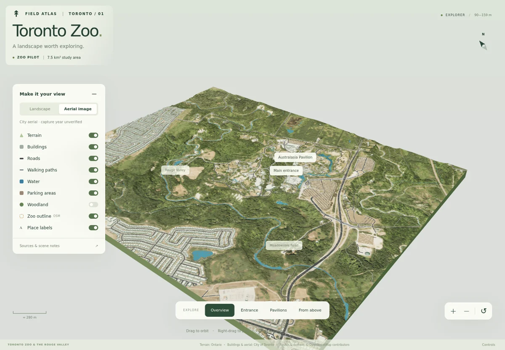

Toronto Zoo Landscape Explorer
=============================

[**Open the GIS-based 3D demo →**](https://mvakili96.github.io/Toronto_Zoo_3D/) · [**Google photorealistic 3D evaluation →**](https://mvakili96.github.io/Toronto_Zoo_3D/google-3d/)

Explore the Toronto Zoo and its immediate surroundings as an interactive 3D landscape. The pilot covers an approximate 7.5 km² study area, bringing together terrain, aerial imagery, buildings and mapped routes.

The demo runs in your browser with no installation. Orbit, pan, zoom, inspect buildings and toggle layers to explore the scene. Aerial imagery is shown by default, and the 3D woodland layer can be switched on.

Google 3D evaluation
--------------------

The optional Google view streams Google’s existing photorealistic terrain, buildings and vegetation. It is a separate view of the same study area. It does not add Google geometry to the GIS model described below. Choose **Open Google 3D** on its welcome screen to load the map.

**Daily quota applies.** All visitors share the project’s Google Demo Key allowance. If the daily limit is reached, the Google view may stop working until the next daily reset. The [GIS-based demo](https://mvakili96.github.io/Toronto_Zoo_3D/) remains available without Google access or quota. This Google view is for evaluation and testing. [Google explains the Demo Key limits](https://developers.google.com/maps/demo-key).

How the visualization was created
----------------------------------

1. **Build the terrain.** Elevation samples from Ontario’s digital terrain model (DTM) form the 3D ground surface, including the hills, slopes and valleys around the Zoo.
2. **Texture the ground.** A georeferenced orthophoto from the City of Toronto provides the terrain’s surface colours and texture.
3. **Add geographic features.** City building models and mapped roads, paths, water, parking and woodland are placed relative to the terrain using their geographic coordinates. These layers are combined in a Three.js viewer for interactive exploration.

Feature positions come from the geographic datasets. No automated image-based alignment or matching is performed. Selected locations were visually checked against the imagery.

Data sources
-------------

| Component | Dataset used |
|---|---|
| Terrain | Ontario’s [lidar-derived Digital Terrain Model](https://data.ontario.ca/dataset/ontario-digital-terrain-model-lidar-derived), using the GTA 2023 DTM package covering the Zoo. |
| Aerial texture | The [City of Toronto orthophoto service](https://gis.toronto.ca/arcgis/rest/services/basemap/cot_ortho/MapServer), cached for the study area on November 7, 2026. The image capture year is unverified. |
| Buildings | The City of Toronto’s [2025 3D Massing dataset](https://open.toronto.ca/dataset/3d-massing/). Existing 3D building geometry is used where available, with footprint extrusions filling gaps. |
| Roads and paths | OpenStreetMap extracts for the Zoo and surrounding Toronto. City of Toronto road and pedestrian centrelines are available as a comparison layer. |
| Woodland, water, parking, place names and Zoo outline | A separate [OpenStreetMap](https://www.openstreetmap.org/copyright) extract for the study area. |

About the representation
-------------------------

Buildings retain simplified massing geometry. The 3D trees are illustrative models placed within mapped woodland areas, with display choices determining their sizes and spacing. Vegetation coverage is incomplete. Feature colours and estimated route widths help make the layers readable.

Data attribution and terms are available through the [Ontario licence](https://www.ontario.ca/page/open-government-licence-ontario), [Toronto licence](https://open.toronto.ca/open-data-licence/) and [© OpenStreetMap contributors, ODbL](https://www.openstreetmap.org/copyright).

For setup and reproducibility, see the [developer guide](docs/DEVELOPMENT.md). Further source decisions and validation are documented in the [technical handoff](HANDOFF.md).
